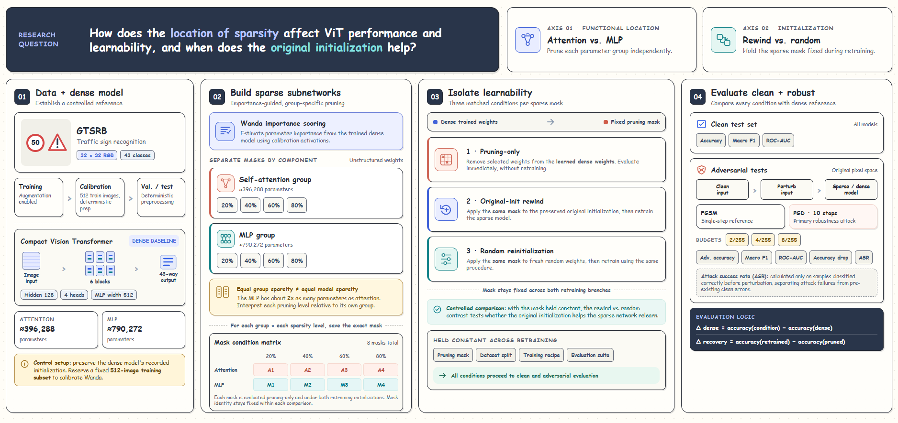
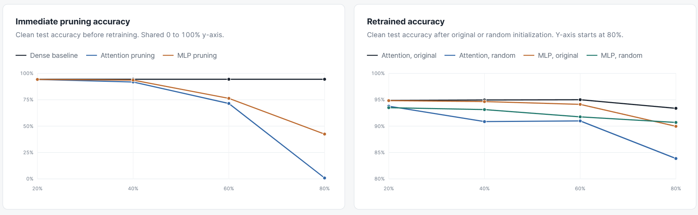
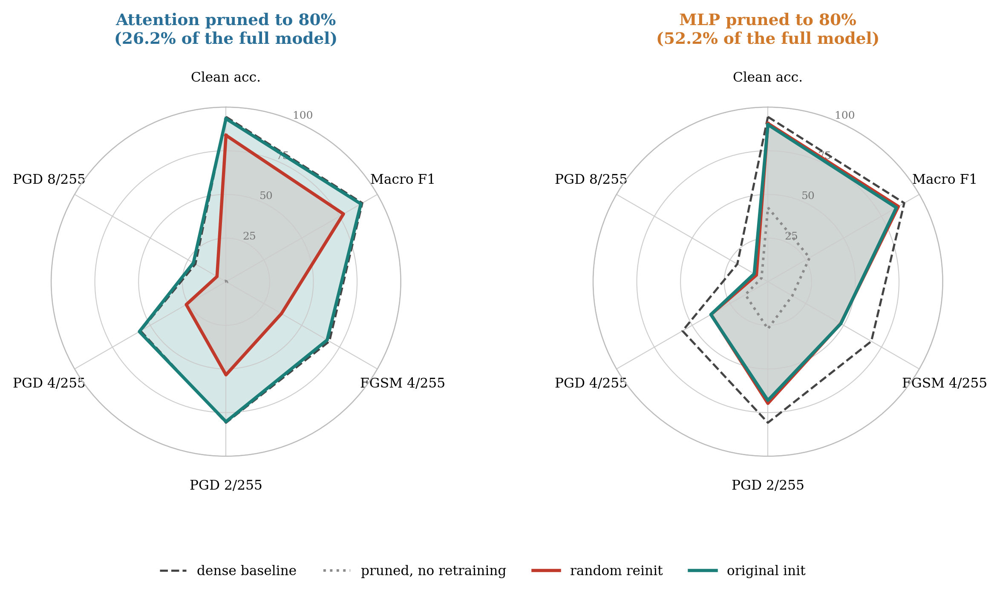
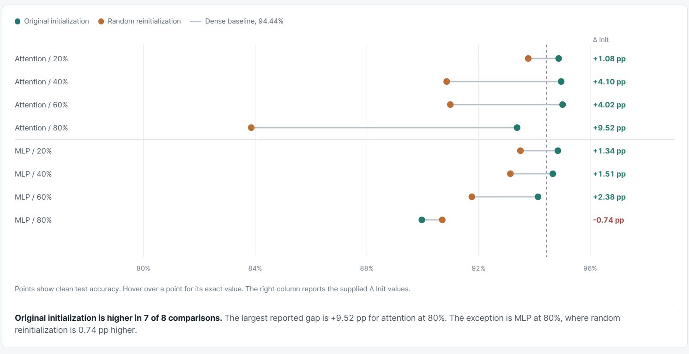
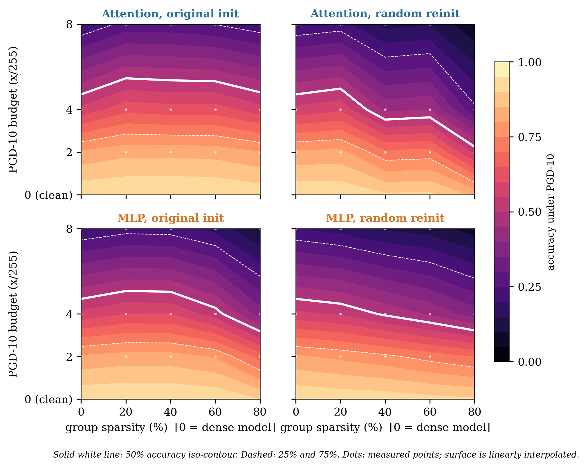

# Sparsity in Vision Transformers

[](https://doi.org/10.5281/zenodo.23546069)

This project studies unstructured pruning in a Vision Transformer (ViT) for
traffic sign recognition. It compares a dense model with models pruned in the
attention and multilayer perceptron (MLP) blocks.



The experiments measure:

- Clean test accuracy.
- Accuracy after pruning.
- Accuracy after retraining.
- The effect of original and random weight initialization.
- FGSM and PGD adversarial robustness.
- Inference time and model sparsity.

View the project results at
[akhilvaidya91.github.io/Sparsity-in-ViT](https://akhilvaidya91.github.io/Sparsity-in-ViT/).

## Experiment overview

The pipeline follows this sequence:

1. Download and prepare the GTSRB dataset.
2. Train a dense ViT baseline.
3. Collect Wanda activation statistics.
4. Create unstructured masks for attention or MLP parameters.
5. Evaluate the pruned model.
6. Run clean and adversarial evaluation.
7. Retrain selected models from original or random initialization.
8. Save metrics, checkpoints, logs, and MLflow runs.

The configured pruning ratios apply to parameters in the selected group. They
do not apply to every parameter in the model.

## Results at a glance

Immediate pruning can reduce accuracy as sparsity increases. Retraining can
recover much of that loss, especially when the model keeps its original
initialization.





The initialization comparison shows the clean accuracy for attention and MLP
pruning at several sparsity levels. Original initialization performs better in
most comparisons in the supplied results.





## Requirements

- Python 3.10 or newer.
- CUDA with a compatible PyTorch build.
- At least two visible GPUs for the complete pipeline.
- [uv](https://docs.astral.sh/uv/) for environment and dependency management.

The retraining stage starts two GPU workers. A single-GPU setup stops before
training starts. You can still inspect or adapt individual modules for a
different hardware setup.

## Install

From the repository root, run:

```bash
uv sync
```

The project is installed as the `vit_pruning` package. The `vit-pruning`
command is also registered as a console entry point.

PyTorch must match the CUDA version on the target machine. If `uv sync` does
not install the correct PyTorch build for your system, install the appropriate
PyTorch packages using the official
[PyTorch installation selector](https://pytorch.org/get-started/locally/).

## Run the pipeline

Start the complete experiment with either command:

```bash
uv run vit-pruning
```

```bash
uv run python -m vit_pruning
```

The first run downloads GTSRB when the dataset is not available locally.
Training and evaluation can take a long time. Check the configured output
directory for progress, checkpoints, and result files.

## Data and output locations

The default locations are:

| Item | Default location |
| --- | --- |
| GTSRB data | `data/gtsrb` |
| Experiment outputs | `outputs/` |
| MLflow database | `outputs/mlflow.db` |

These defaults are not tied to Kaggle paths. Change them with environment
variables when needed:

| Variable | Purpose |
| --- | --- |
| `GTSRB_DATA_ROOT` | Dataset directory |
| `OUTPUT_DIR` | CSV files, logs, checkpoints, and other outputs |
| `MLFLOW_TRACKING_URI` | MLflow tracking store |
| `MLFLOW_EXPERIMENT_NAME` | MLflow experiment name |

For example, on Linux or macOS:

```bash
export GTSRB_DATA_ROOT="$HOME/datasets/gtsrb"
export OUTPUT_DIR="$HOME/experiments/vit-pruning"
```

On Windows PowerShell, use:

```powershell
$env:GTSRB_DATA_ROOT = "$HOME\datasets\gtsrb"
$env:OUTPUT_DIR = "$HOME\experiments\vit-pruning"
```

## Track runs with MLflow

The pipeline logs training settings, epoch metrics, final test metrics,
early-stopping details, and training time. It also logs clean results for
pruning-only models and clean and adversarial results for attack runs.

Start the MLflow interface in a second terminal:

```bash
uv run mlflow ui --backend-store-uri sqlite:///outputs/mlflow.db
```

Open the local address printed by MLflow. If you set
`MLFLOW_TRACKING_URI` or `OUTPUT_DIR`, point the MLflow interface to the same
tracking store.

The default experiment name is `vit-structured-pruning`.

## Code structure

The source files are under `src/` and are packaged as `vit_pruning` by
`pyproject.toml`.

| Module | Responsibility |
| --- | --- |
| `config.py` | Model, training, data, output, and MLflow settings |
| `reproducibility.py` | Seeds and model-state utilities |
| `data.py` | GTSRB transforms, splits, and data loaders |
| `model.py` | Masked ViT layers and the full model |
| `pruning.py` | Wanda scores and unstructured masks |
| `evaluation.py` | Clean evaluation and inference timing |
| `adversarial.py` | FGSM, PGD, and adversarial metrics |
| `training.py` | Optimizer, checkpoints, early stopping, and MLflow runs |
| `results.py` | CSV schemas and output helpers |
| `experiments.py` | Dense runs, pruning evaluation, and multi-GPU retraining |
| `tracking.py` | Shared MLflow configuration and logging helpers |
| `pipeline.py` | End-to-end experiment orchestration |
| `__main__.py` | Package entry point |

Supporting notebooks are in [`notebooks/`](notebooks/). They provide analysis
for training, retraining, and adversarial results.

## Repository layout

```text
.
├── assets/          Result graphics used in this README
├── notebooks/       Result analysis notebooks
├── src/             The vit_pruning package
├── results/         Example CSV result files
├── CODE_STRUCTURE.txt
├── pyproject.toml
└── uv.lock
```